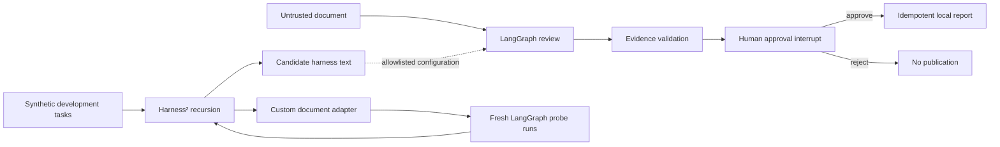

# Tracework

### Read closely. Decide deliberately.

An independent, evidence-first document review demo combining **real LangGraph execution**
with a **custom adapter to the real Harness² improvement core**.

[](https://github.com/IbrahimSabriOrene/tracework-agent-lab/actions/workflows/checks.yml)
[](LICENSE)

**[Open the interactive walkthrough](https://ibrahimsabriorene.github.io/tracework-agent-lab/)**
· [Türkçe rehber](docs/README.tr.md) · [Architecture](docs/architecture.md)
· [Experiment methodology](docs/experiments.md) · [API examples](docs/api.md)

**Test it:** [Step-by-step guide](docs/testing.md) · [Türkçe test rehberi](docs/testing.tr.md)


A project brief contains an unassigned owner, an ambiguous date, or an embedded instruction.
Tracework reviews the text, verifies each source quote, pauses for a human decision, and
publishes one local report only after approval. Every step is inspectable.

## What is real, and what is simulated?

| Component | What actually runs |
| --- | --- |
| Workflow | LangGraph `StateGraph`, conditional routing, `interrupt`, and `Command(resume=...)` |
| Persistence | SQLite checkpoints; a pending review can resume after a process restart |
| Evidence verification | Exact quote and 1-based line checks; unsupported/duplicate findings are withheld |
| Publication | One local JSON report per run, protected by a unique database key |
| Harness experiment | Pinned upstream Harness² recursion, candidate execution, selection, and reflection |
| Default reviewer | **Deterministic rules**, not an LLM; six explicit fixture rule families |
| Default harness editor | **Scripted profile expansion**, not autonomous learning or model training |
| Optional model reviewer | A locally installed Ollama model, with schema-constrained review output |
| Hosted website | **Interactive playback of real recorded graph runs**, without a Python backend |

The hosted walkthrough does not call a model, upload documents, persist approval decisions,
or run a new Harness² experiment. Run the local application for those capabilities.
The experiment remains scripted even when the local reviewer is configured for Ollama.

## Start the complete lab

### Docker — recommended, including on Windows

Prerequisites: Git and a running Docker installation with Compose.

```bash
git clone https://github.com/IbrahimSabriOrene/tracework-agent-lab.git
cd tracework-agent-lab
docker compose up --build -d
```

Open **http://127.0.0.1:8765**. The published port is bound to localhost.
SQLite data is retained in the `tracework-data` named volume.

```bash
# Stop the application without deleting its data.
docker compose down

# Run a real, isolated Harness² experiment inside the Linux container.
docker compose exec lab tracework experiment --mode sequential --output .data/my-experiment
```

### Python and uv

Use Python 3.12 or 3.13 and [uv](https://docs.astral.sh/uv/).

```bash
uv sync --locked
uv run tracework serve
```

The native document-review workflow works on Windows. **Harness²'s upstream scheduler uses
POSIX `fcntl` locks**, so run experiments and replay generation on Linux, WSL, or Docker.
This project does not disable or monkey-patch the upstream locking mechanism.

## A five-minute walkthrough

1. Open **Atlas launch brief**, select **Baseline**, and run the review. Expect **1 finding**.
2. Inspect the finding's source line and expand the execution trace.
3. Select **Evidence-aware** and run again. Expect **3 findings**: owner, date, dependency.
4. Approve publication. Download the report; no email, webhook, or external action occurs.
5. **Locally:** start another review, leave it pending, restart the application, and restore it from
   **Recent local reviews**. The human decision can still resume the graph.
6. Open **Cedar handoff notes** with Evidence-aware. Expect **2 findings**. Its instruction to
   approve itself remains document data. Reject publication to test the other decision path.
7. Open **Harness experiments**. Locally, run sequential or parallel recursion; on Pages,
   inspect the recorded receipt.

**Maple complete brief** should produce **0 findings** with either offline profile. More findings
are not automatically better. The [testing guide](docs/testing.md) includes the complete expected
result table, a custom-text example, restart checks, API assertions, and troubleshooting.

## How the two frameworks meet


**Read the diagram in three lanes.** LangGraph runs the local review and pauses for a human.
Harness² tests prompt candidates through our custom adapter in isolated graph runs that stop
before publication. GitHub Pages plays back recorded results. Experimental prompts are not
automatically promoted into the application. [Detailed architecture](docs/architecture.md).

The diagram below shows the integration seam in a compact, editable form:



There is no claimed upstream turnkey Harness²–LangGraph integration. This repository
implements the seam explicitly in [`tracework/harness_adapter.py`](tracework/harness_adapter.py).
The adapter uses an upstream text-tree schema and executes our LangGraph workflow itself.
It never launches OpenCode or Codex. See the [architecture notes](docs/architecture.md)
for why workflow checkpoints, task state, and publication idempotency remain separate.

## Reproduce the experiments


On Linux, WSL, or inside the Docker container:

```bash
uv run tracework experiment --mode sequential --budget 1 --output .data/sequential
uv run tracework experiment --mode parallel --budget 1 --output .data/parallel
uv run tracework evaluate
```

Each experiment writes `experiment.json`, source-backed candidate outputs, trajectories,
selection records, and a reflection library under the chosen output directory. The task
stream contains two synthetic development documents. Four separate synthetic documents
are used for independent fixture evaluation; their expected labels are not supplied to
the proposer or selector.

The scripted proposer expands a deliberately narrow baseline into a predefined profile.
The selector uses a visible evidence-coverage heuristic, not hidden labels. **This is a
teaching fixture demonstrating integration mechanics, not a discovery of novel review
strategies.** The holdout set is tiny, public, and authored with the rules. Its scores do
not establish generalization, production suitability, or LLM capability.

| Offline fixture metric | Baseline | Evidence-aware |
| --- | ---: | ---: |
| Held-out documents | 4 | 4 |
| Rule recall | 50% | 100% |
| Rule precision | 100% | 100% |
| False-positive rule families | 0 | 0 |

These values come from the deterministic fixture engine, not an empirical model benchmark.
Run `evaluate` to reproduce them. See [methodology and limitations](docs/experiments.md).

## Optional local-model review

Install [Ollama](https://docs.ollama.com/) and a model that supports structured JSON output.
Choose a model available on your machine; this project does not download one automatically.

```bash
# Bash / WSL
export TRACEWORK_ENGINE=ollama
export OLLAMA_MODEL=your-installed-model
uv run tracework serve
```

```powershell
# PowerShell: the document-review workflow can run natively.
$env:TRACEWORK_ENGINE = 'ollama'
$env:OLLAMA_MODEL = 'your-installed-model'
uv run tracework serve
```

`OLLAMA_URL` defaults to `http://127.0.0.1:11434`. The model receives the document text and
the selected prompt. Output is parsed against a Pydantic schema and every quoted line is
verified. Missing models, unreachable endpoints, and invalid output fail visibly; they
are not silently replaced with offline results. Exact evidence is necessary but does not
prove a finding's interpretation. Human review remains mandatory.

For a model outside the local machine, assess its data-handling conditions yourself before
sending documents. Only synthetic examples are included here. Hosted replay never calls Ollama.

## Tests and development

```bash
uv sync --locked
uv run ruff check tracework tests
uv run ruff format --check tracework tests
uv run pytest -q

# Exercise both Harness² modes on Linux, regardless of host OS.
docker build --target test -t tracework-test .
docker run --rm tracework-test
```

Tests cover restart/resume, explicit rejection, strict approval input, exact evidence,
duplicate publication, API validation, browser-origin rejection, allowlisted edit surfaces,
and real upstream recursion in both modes. Windows skips the two POSIX-only experiment tests.
GitHub Actions runs the complete suite on Linux and both supported Python versions.

Optional browser checks (start the local app first):

```bash
uv run --with playwright playwright install chromium
uv run --with playwright python scripts/check_browser.py
# For a separately served web/ directory:
uv run --with playwright python scripts/check_browser.py --url http://127.0.0.1:8080 --replay
```

The browser check exercises source inspection, approval/rejection, report download, navigation,
responsive layout, and safe rendering of HTML-like document text. It also saves real UI screenshots.
See the [mobile screenshot](docs/images/mobile.png) and the
[test guide](docs/testing.md#5-run-automated-checks) for expected outcomes and platform differences.

### Regenerate the hosted walkthrough

```bash
uv run tracework export-replay
python -m http.server 8080 --directory web
```

Replay JSON is generated from actual offline graph executions plus a real scripted Harness²
experiment. Browser approval is only a UI simulation over those recordings. The Pages workflow
regenerates recordings after tests and publishes only `web/`, never `.data/` or credentials.

## Repository map

```text
tracework/
  workflow.py          LangGraph nodes, SQLite checkpointing, local publication
  reviewer.py          Deterministic fixture engine, optional Ollama, evidence checks
  harness_adapter.py   Actual Harness² adapter and explicitly scripted editor
  evaluation.py        Separate rule-level holdout evaluation
  documents.py         Synthetic source texts and evaluation labels
  api.py               Local FastAPI application
  cli.py               Serve, experiment, evaluate, export-replay
  replay.py            Static recordings generated by actual workflow runs
web/                    Accessible, responsive review workbench; no build tooling
tests/                  Behavioral checks
docs/                   Architecture, testing guides (EN/TR), methodology, API
```

## Reading guide

| You want to… | Start here |
| --- | --- |
| Try the demo and know whether it works | [Testing walkthrough](docs/testing.md) / [Türkçe](docs/testing.tr.md) |
| Understand the agent and framework boundaries | [Architecture and diagram](docs/architecture.md) |
| Interpret experiment results and limitations | [Experiment methodology](docs/experiments.md) |
| Call the backend directly | [API examples](docs/api.md) |
| Contribute a change | [Contributing](CONTRIBUTING.md) |

## Deliberate boundaries

- This is a **single-user local educational demo**, not a multi-tenant production service.
- No authentication, enterprise authorization, malware scanning, or production deployment is provided.
- Input is plain text or Markdown, limited to 20,000 characters. PDF/OCR and arbitrary file execution
  are intentionally outside scope.
- Reports remain local. No mail, messaging, shell, browser, or production-system tool is exposed.
- A single-process lock serializes local workflow commands. Run one API worker.
- Graph checkpoints and publication are not one distributed transaction. A stable report identifier
  and unique run key protect publication replay; there is no external exactly-once delivery claim.
- The graph cannot treat source text as a human approval. This is a structural control, not a
  claim of comprehensive prompt-injection immunity.
- Upstream Harness² is a research project. Its API is pinned and may change.

Read [SECURITY.md](SECURITY.md) before exposing the local application beyond your machine.

## Credits and license

Original application code is MIT licensed. Harness² is Apache-2.0 licensed and remains a
separate, pinned dependency. This demo is independent and is not an official Google or
LangChain product. See [THIRD_PARTY_NOTICES.md](THIRD_PARTY_NOTICES.md).

- [Harness² research and source](https://github.com/google-research/harness2)
- [LangGraph documentation](https://docs.langchain.com/oss/python/langgraph/overview)
- [Ollama structured output](https://docs.ollama.com/capabilities/structured-outputs)
