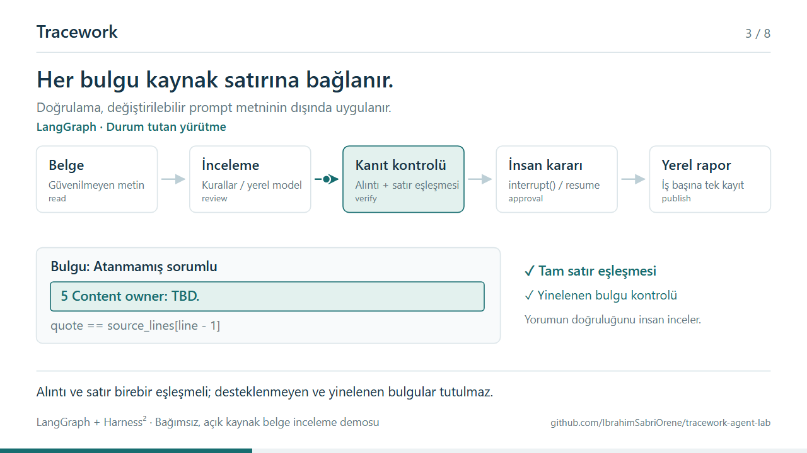

# Architecture in motion

[Interactive player](https://ibrahimsabriorene.github.io/tracework-agent-lab/animation.html) ·
[MP4 video](https://ibrahimsabriorene.github.io/tracework-agent-lab/media/tracework-flow.mp4) ·
[Architecture](architecture.md)



The animation explains the public demo's implementation in Turkish. It is a scripted visual
explanation, not a recording of live requests, an autonomous model, or a performance benchmark.
Its timing is chosen for reading. No document is processed by opening the player.

## Storyboard

| Time | Chapter | What the viewer sees |
| --- | --- | --- |
| 00:00–00:06 | Document | Synthetic Atlas source enters the workflow as untrusted text |
| 00:06–00:12 | LangGraph | `StateGraph` manages steps; two allowed offline profiles produce 1 and 3 findings |
| 00:12–00:18 | Evidence | A finding must quote its complete source line; duplicates are withheld |
| 00:18–00:24 | Human decision | `interrupt()` suspends work; `SQLiteSaver` preserves the same thread's state |
| 00:24–00:30 | Resume and report | `Command(resume=...)` routes to publication or rejection; unique run key protects the report |
| 00:30–00:36 | Harness² | Real upstream Propose–Probe–Compose uses development tasks and a scripted editor |
| 00:36–00:42 | Adapter | `DocumentAdapter.execute()` runs a fresh LangGraph probe that stops before publication |
| 00:42–00:48 | Hosted demo | Recorded graph/experiment results become static JSON for interactive playback |

The fixed `review → verify → approval` structure does not become editable by an experimental
candidate. The experiment does not automatically deploy its chosen prompt to the local app.
Holdout evaluation remains separate from development adaptation.

## Watch or share

The browser player has play/pause, restart, seeking, and direct chapter selection. It starts
paused. `?autoplay=1` enables one playback unless reduced motion is requested by the device.
Backgrounding the tab pauses playback. The MP4 is silent, has readable on-screen explanations,
and contains no third-party brand assets or material from a private project.

For LinkedIn, download `tracework-flow.mp4` and upload it as the post's video. A link to the
player opens the interactive version; the MP4 itself does not have clickable player controls.

## Edit and reproduce

Sources are `web/animation.html`, `web/animation.css`, and `web/animation.js`. The SVG is generated
from an eight-scene storyboard. A deterministic `window.traceworkAnimation.seek(milliseconds)`
function makes browser playback, testing, and video export use the same frame state.
No animation framework, CDN, live model, or backend is required for the player.

From the repository root, serve the static files:

```bash
python -m http.server 8088 --directory web
```

In another terminal, install a browser if needed and export:

```bash
uv run --with playwright playwright install chromium
uv run --with playwright --with imageio-ffmpeg python scripts/export_animation.py
```

The export tool renders 1,152 frames and encodes them using the optional imageio-ffmpeg binary.
It writes `web/media/tracework-flow.mp4` and `docs/images/animation.png`, replacing existing
exports. The output is H.264, 1280 × 720, 24 fps, 48 seconds, YUV 4:2:0, without audio.
Alternative input URLs and output locations are available through `--help`.

The existing browser check also verifies all eight chapter selections, timeline seeking,
play/pause, SVG text bounds, mobile page width, and reduced-motion autoplay behavior:

```bash
uv run --with playwright python scripts/check_browser.py --url http://127.0.0.1:8088 --replay
```

If the workflow changes, update the storyboard, run the browser check, and regenerate the MP4
and preview before publishing. Video encoding is a manual authoring step; CI checks the player
and publishes the committed export.
