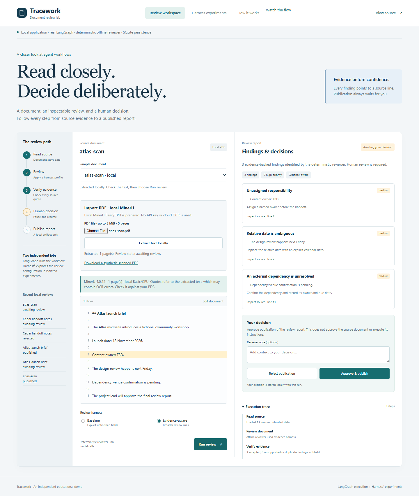

# MinerU ile ücretsiz ve yerel PDF inceleme

[English guide](pdf.md) · [Test rehberi](testing.tr.md) · [Proje özeti](README.tr.md)

PDF, **MinerU 4.0.12 Basic / ONNX** ile bilgisayarınızın CPU'sunda metne dönüştürülür.
Çıkarılan metni kontrol ettikten sonra mevcut LangGraph inceleme ve insan onayı akışına
devam edersiniz. API anahtarı veya ücretli OCR servisi gerekmez.



## Yerel kurulum

Depo kökünde:

```bash
uv sync --locked
uv run python scripts/setup_pdf.py
uv run tracework serve
```

Kurulum için [uv](https://docs.astral.sh/uv/) gerekir. Betik Python 3.12 ile ayrı bir `.mineru/`
ortamı oluşturur, MinerU 4.0.12'yi kurar, Basic/ONNX modellerini indirip dosyaları doğrular.
İlk seferde model dosyaları için yaklaşık **850 MB**, ayrıca Python paketleri indirilir.
Sonraki OCR işlemleri yerel model önbelleğiyle çalışır; buluta geçiş yapılmaz. GPU zorunlu değildir.

**http://127.0.0.1:8765** adresini açın. Sayfa kurulum sırasında açıksa yenileyin.
`/api/health` içindeki `pdf.available` hazır olduğunda `true` olur. Bu alan kurulum durumunu
gösterir; her PDF'nin başarıyla işleneceği anlamına gelmez.

`TRACEWORK_DATA_DIR` kullanıyorsanız kurulum ve sunucuyu aynı değerle çalıştırın. Model önbelleği
bu veri dizinindedir. İleri kullanımda `TRACEWORK_MINERU_PYTHON`, tam olarak MinerU 4.0.12 kurulu
başka bir izole Python ortamını seçebilir.

## Docker ile kurulum

Temel Docker imajına OCR zorunlu olarak eklenmez. PDF desteği için:

```bash
docker compose -f compose.yaml -f compose.pdf.yaml up --build -d
docker compose -f compose.yaml -f compose.pdf.yaml exec lab /app/.venv/bin/python scripts/setup_pdf.py
```

Model hazırlığı bitince yerel sayfayı yenileyin. Mevcut adlandırılmış volume; modelleri,
çıkarılmış metinleri, inceleme durumlarını ve raporları korur. GitHub Pages'i açmak model
indirmez ve orada PDF yükleme çalışmaz.

## PDF yükleyip incelemeye devam etme

1. [Kurgu Atlas tarama örneğini](../web/samples/atlas-scan.pdf) indirin. Dosyada metin katmanı
   yoktur; sayfa bir görseldir ve okunabilmesi için gerçek OCR gerekir.
2. Yerel uygulamadaki **Import PDF · local MinerU** alanında dosyayı seçin.
   **Extract text locally** düğmesine basın. CPU üzerinde birkaç dakika sürebilir.
3. Çıkan metni özgün PDF ile karşılaştırın. Gerekirse **Edit document** ile düzeltin.
   Henüz bir inceleme veya rapor oluşturulmuş değildir.
4. **Evidence-aware** seçip **Run review** düğmesine basın. Örnek dosyada sorumlu, belirsiz tarih
   ve bekleyen bağımlılık olmak üzere **3 bulgu** beklenir. Baseline **1 bulgu** üretir.
5. **Inspect source** ile alıntı satırlarını inceleyin. **Approve & publish** ile raporu kaydedin
   veya **Reject publication** ile reddedin.
6. JSON raporunu indirip `source` alanını kontrol edin. PDF hash'i, sayfa sayısı, MinerU sürümü
   ve metnin çıkarıldıktan sonra değiştirilip değiştirilmediği burada bulunur.
7. Başka bir incelemeyi beklemede bırakıp sunucuyu yeniden başlatın. Aynı veri diziniyle
   **Recent local reviews** üzerinden devam edin; metin ve PDF kaynak bilgileri korunur.

PDF desteği varsayılan inceleyiciyi genel bir dil modeline dönüştürmez. Mevcut çevrimdışı
kurallar belirli İngilizce örüntüleri arar. İsteğe bağlı Ollama incelemesi ayrı yapılandırılır.

## Kaynak ve doğrulama

| Rapor alanı | Anlamı |
| --- | --- |
| `source.filename` | Yüklenen dosyanın klasör yolu içermeyen adı |
| `source.pdf_sha256` | Özgün PDF dosyasının hash'i |
| `source.pages` | Sayfa sayısı; eksik sayfa sonucu kabul edilmez |
| `source.parser_version` / `tier` | MinerU sürümü ve Basic katmanı |
| `source.extracted_text_sha256` | İlk çıkarılan metnin hash'i |
| `source.text_edited` | İncelenen metin ilk çıkarılan metinden farklı mı? |
| `source.import_id` | Yerel çıkarma kaydının kimliği |
| `document_sha256` | Gerçekte incelenen son metnin hash'i |

**Alıntı doğrulaması çıkarılmış veya düzeltilmiş metin üzerinde yapılır.** OCR'ın PDF'deki
harfleri doğru okuduğunu bağımsız olarak doğrulamaz. Satır numaraları ekranda görünen metne
aittir; PDF koordinatı veya basılı sayfa satır numarası değildir. OCR HTML'i çalıştırılmaz.

## Sınırlar ve veriler

- En fazla **5 MiB**, **5 sayfa**, **20.000 çıkarılmış karakter**; aynı anda tek PDF.
- Şifreli/bozuk PDF, aşırı büyük sayfa boyutları ve boş/fazla uzun metin reddedilir.
- Sayfa atlama, metni sessizce kesme, başka OCR motoruna veya buluta geçme yoktur.
- İşçi işleminde 10 dakika sınırı vardır. Sunucudaki yükleme kopyası ve geçici iş dosyaları
  iş sonunda temizlenir. Özgün PDF bilgisayarınızda kalır.
- Çıkarılmış metin ve bilgiler `.data/pdf-imports/` altında; inceleme ve raporlar SQLite'ta
  yerel olarak saklanır. Hata durumunda sınırlı `.data/pdf-worker.log` tanı kaydı tutulur.
  Bu veriler Git tarafından yok sayılır.
- Kurulum ve işçi, uygulamaya ait MinerU yapılandırmasını kullanır. Global MinerU ayarları,
  uzak MinerU API'si veya LLM destekli son işleme kullanılmaz.
- Arayüzde veri silme yönetimi yoktur; tanıtımda yalnızca kurgu belgeler kullanın.

## Test etme

Model indirmeyen davranış testleri:

```bash
uv run pytest tests/test_pdf.py -q
```

Yerel sunucu ve modeller hazırken gerçek OCR'ı tarayıcıdan test edin:

```bash
uv run --with playwright playwright install chromium
uv run --with playwright python scripts/check_browser.py --pdf
```

Bu komut taranmış örneği yükler, beklenen üç bulguyu ve kaynak satırını kontrol eder, raporu
onaylar, indirilen JSON'daki PDF bilgilerini doğrular ve `docs/images/pdf-import.png` oluşturur.
Normal CI testi model indirmez; kontrollü işçi yanıtı üzerinden API davranışını test eder.

| Sorun | Çözüm |
| --- | --- |
| Yükleme düğmesi kapalı | Yerel uygulamayı açın, aynı veri diziniyle kurulumu tamamlayın ve sayfayı yenileyin |
| Model indirme hatası | Hugging Face/ModelScope erişimini kontrol edip kurulum betiğini yeniden çalıştırın |
| 502 işçi hatası | `.data/pdf-worker.log` kaydını inceleyip sabit sürüm kurulumunu doğrulayın |
| Zaman aşımı / fazla uzun metin | PDF'yi daha küçük parçalara bölün |
| Metin doğru ama bulgu az | Çevrimdışı kurallar sınırlıdır; isteğe bağlı yerel model kullanın veya elle inceleyin |

MinerU ayrı bir bağımlılıktır. Sürüm 4.0.12, Apache 2.0 yanında ek şartlar içeren
[MinerU lisansına](https://github.com/opendatalab/MinerU/blob/master/LICENSE.md) tabidir;
model dosyalarının da kendi lisansları vardır. Ayrıntılar [üçüncü taraf bildirimlerinde](../THIRD_PARTY_NOTICES.md)
ve [resmî yerel SDK belgesinde](https://opendatalab.github.io/MinerU/usage/sdk_api/) bulunur.
