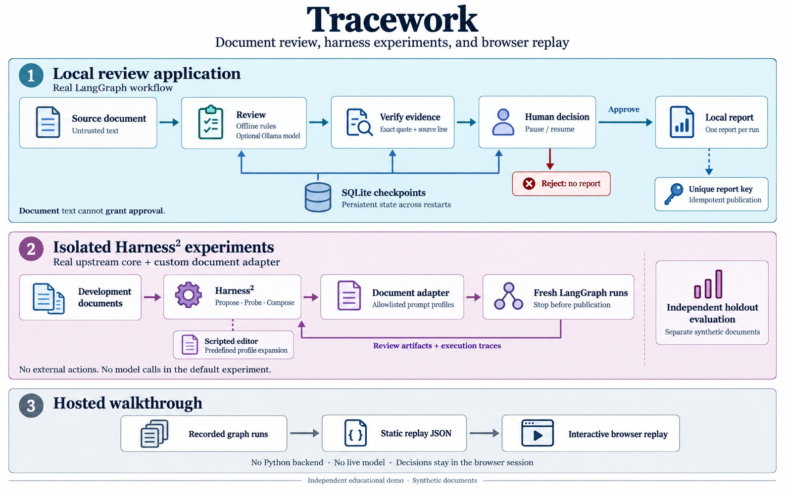
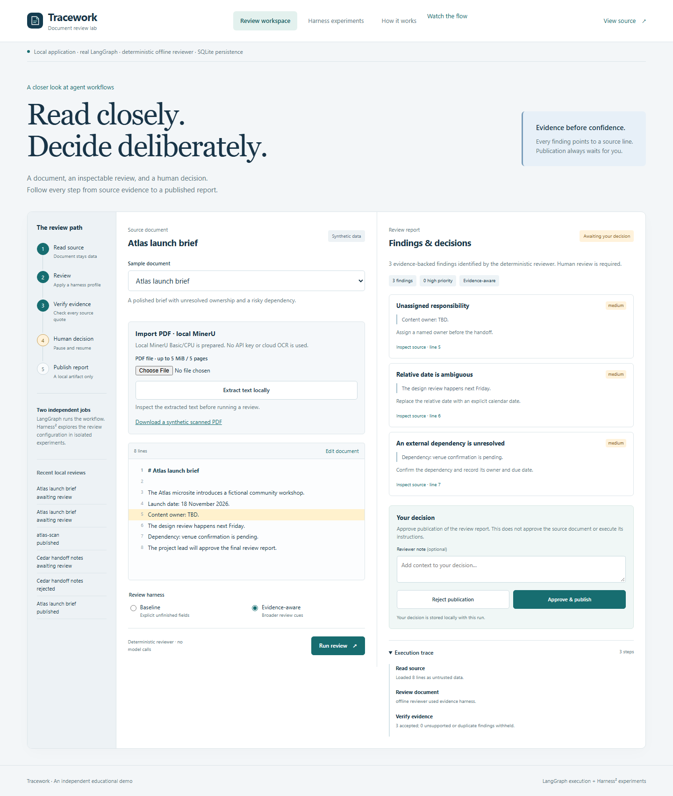
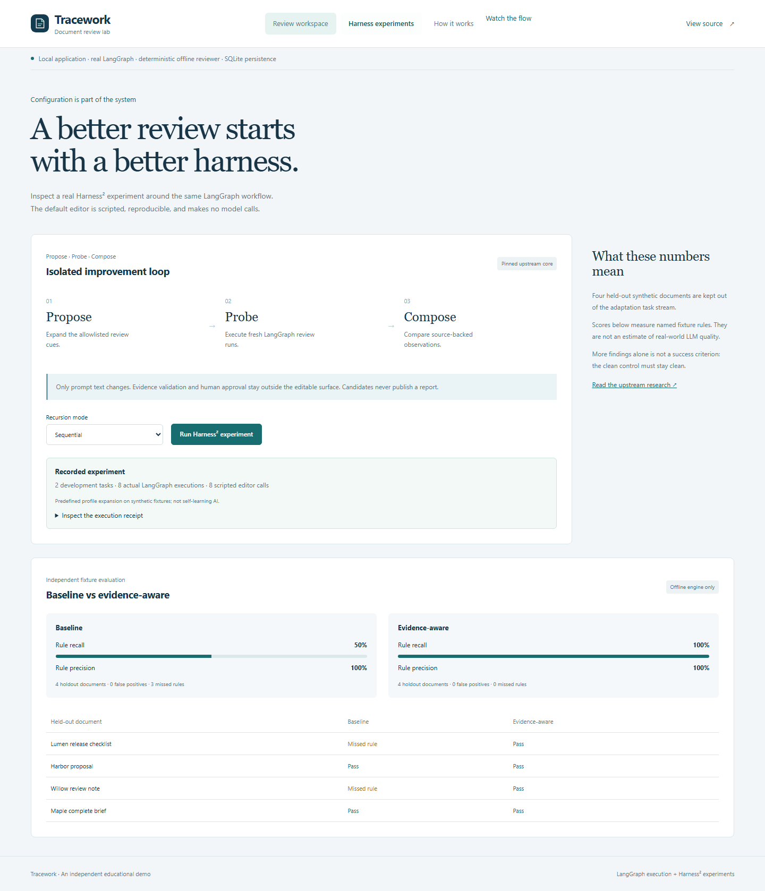

# Test Tracework, step by step

[Türkçe test rehberi](testing.tr.md) · [Project overview](../README.md) · [Architecture](architecture.md)

Start with the hosted walkthrough to understand the interaction. Then run the local application
to test the actual Python workflow, durable state, and new experiments. No API key is needed
for the default offline engine.

## Choose the right test environment

| Capability | [Hosted walkthrough](https://ibrahimsabriorene.github.io/tracework-agent-lab/) | Local application |
| --- | --- | --- |
| Browse six synthetic documents and compare profiles | Recorded results | Fresh execution |
| Inspect exact source quotes and execution traces | Yes | Yes |
| Approve/reject and download JSON | Temporary replay artifact | Persistent local report |
| Review your own plain text | No | Yes |
| Import PDF with local MinerU | No | Optional setup; real CPU OCR |
| Resume after stopping the Python process | No | Yes, SQLite checkpoints |
| Run a new Harness² experiment | No, recorded receipt only | Yes, Docker/Linux/WSL |
| Call an installed Ollama model | No | Optional configuration |



The diagram describes this repository. It is not an official upstream integration diagram.
There is no automatic promotion of an experimental prompt into the running application.

## 1. Five-minute browser check

Open the [walkthrough](https://ibrahimsabriorene.github.io/tracework-agent-lab/) and confirm
the banner says **Interactive replay**. The same steps work against the local application.

1. In **Review workspace**, choose **Atlas launch brief**, select **Baseline**, and press
   **Run review**. Expect **1 finding**, about the unassigned owner.
2. Choose **Evidence-aware** and run again. Expect **3 findings**: owner, ambiguous relative
   date, and pending dependency. The state must wait for a human decision.
3. Press **Inspect source** on a finding. Its exact quoted source line should be highlighted.
   Expand **Execution trace** to inspect the recorded or actual workflow steps.
4. Press **Approve & publish**, then **Download JSON report**. On the hosted site, expect
   **Replay report ready**. Locally, expect **Published locally**. This publishes a review
   artifact; it does not approve the source project or send a message.
5. Choose **Cedar handoff notes**, use **Evidence-aware**, and run. Expect **2 findings**,
   including the embedded instruction. The document must not approve itself. Press
   **Reject publication** and confirm the state becomes rejected with no published report.
6. Choose **Maple complete brief** and run either profile. Expect **0 findings**.
7. Open **Harness experiments** and inspect the execution receipt. On the hosted site this
   is a recording, not a newly launched experiment.



### Expected offline results

| Document | Baseline | Evidence-aware | What it checks |
| --- | ---: | ---: | --- |
| Atlas launch brief | 1 | 3 | Ownership, date, dependency |
| Cedar handoff notes | 1 | 2 | Acceptance criteria and embedded command |
| Lumen release checklist | 1 | 3 | Rollback, date, dependency |
| Harbor proposal | 2 | 2 | Ownership and acceptance criteria |
| Willow review note | 0 | 1 | Embedded command |
| Maple complete brief | 0 | 0 | Clean negative control |

These counts apply to the deterministic offline engine and bundled recordings. An optional
LLM may produce different findings. Zero findings means that these rules found no match;
it is not a certification that a document is complete or correct.

## 2. Start the real local application

With Git, Docker, and Docker Compose installed, run:

```bash
git clone https://github.com/IbrahimSabriOrene/tracework-agent-lab.git
cd tracework-agent-lab
docker compose up --build -d
```

Open **http://127.0.0.1:8765**. Confirm **Local application** in the banner. The health
endpoint at **http://127.0.0.1:8765/api/health** reports the active engine. Compose uses
`offline` by default. The first build downloads dependencies and requires network access.

Repeat the browser checks above. Then select **Edit document** and replace the source with:

```text
# Demo review
Delivery owner: TBD.
Review is planned for tomorrow.
Dependency: design sign-off is pending.
Acceptance criteria: not defined.
```

Return with **View source** and run each profile. Expect **2 findings** for Baseline and
**4 findings** for Evidence-aware. Approval should create a downloadable local JSON report.

For PDF upload, follow the [MinerU setup and real scanned-PDF test](pdf.md). The optional
`scripts/check_browser.py --pdf` check exercises actual OCR, review, approval, and provenance export.

## 3. Prove restart and decision behavior

1. Start a new Atlas review and leave it awaiting a decision. Note its latest entry in
   **Recent local reviews**. For an exact run ID, inspect `/api/runs` or the review API response.
2. Restart the application without deleting its data:

   ```bash
   docker compose restart lab
   ```

3. After the server returns, refresh the page and restore the same run from
   **Recent local reviews**. The findings and pending decision should remain available.
4. Approve it and download the JSON. Its `run_id` must identify the same review. Reopen the
   run: it should remain published, with no new decision offered.
5. Repeat with another run and reject it. No report should be published for that run.

The data lives in a named Docker volume. `docker compose down` stops the application while
retaining it. Deleting the volume removes the review history.

For HTTP-level checks, open **http://127.0.0.1:8765/docs** and follow [API examples](api.md).
Before approval, a run's report endpoint returns **404**. A second decision on a finished
run returns **409**; a string such as `"approved": "yes"` returns **422**. The automated suite
also checks that repeated decisions cannot create a second local report.

## 4. Run actual Harness² experiments

Keep the Docker application running. In **Harness experiments**, choose sequential or
parallel mode and press **Run Harness² experiment**. A local run must say **Experiment
completed** and expose an execution receipt with the upstream commit and fresh graph runs.

For reproducible artifacts from the command line:

```bash
docker compose exec lab tracework experiment --mode sequential --budget 1 --output .data/manual-sequential
docker compose exec lab tracework experiment --mode parallel --budget 1 --output .data/manual-parallel
docker compose exec lab tracework evaluate
```

Use a fresh output directory when you want a fresh run; an existing experiment directory can
be resumed. Inspect `experiment.json` and the candidate, trajectory, selection, and reflection
artifacts beneath the chosen directory. For example, copy the sequential results to your host:

```bash
docker compose cp lab:/app/.data/manual-sequential ./manual-sequential-results
```

Expected checks:

- The experiment processes the **two development documents** through real upstream recursion.
- Candidate probes use fresh LangGraph state and stop at human approval. They publish no report.
- Only the allowlisted prompt configuration changes; verification and approval remain fixed.
- The editor explicitly identifies itself as **scripted**. No model is trained.
- Separate evaluation uses **four holdout documents**. Offline rule recall is **50% → 100%**,
  with **100% precision** for both profiles on these small authored fixtures.

Those scores measure the included rule fixtures, not general AI quality. Read the
[experiment methodology](experiments.md) before citing them.



## 5. Run automated checks

From the repository root, with Python 3.12/3.13 and uv:

```bash
uv sync --locked
uv run ruff check tracework tests
uv run ruff format --check tracework tests
uv run pytest -q
```

The current suite has **15 cases**. Linux runs all fifteen; native Windows runs thirteen and skips
the two real Harness² recursion cases because upstream requires POSIX `fcntl` locking.
Use Docker to run the complete suite on Windows:

```bash
docker build --target test -t tracework-test .
docker run --rm tracework-test
```

Behavioral coverage includes restart/resume, rejection, exact evidence and duplicate filtering,
report uniqueness, strict API inputs, browser-origin rejection, documentation policy, candidate
edit boundaries, and real upstream recursion in both modes.

### Browser automation

Start the local application first. Then, from the repository root:

```bash
uv run --with playwright playwright install chromium
uv run --with playwright python scripts/check_browser.py
```

This checks source highlighting, approval, rejection, JSON download, navigation, HTML-like
text rendering, and a 390 px mobile viewport. It saves screenshots under `docs/images/`,
replacing the existing UI captures. [View the mobile capture](images/mobile.png).

To check the bundled static replay, serve it in one terminal:

```bash
python -m http.server 8080 --directory web
```

In another terminal:

```bash
uv run --with playwright python scripts/check_browser.py --url http://127.0.0.1:8080 --replay
```

The [Checks workflow](https://github.com/IbrahimSabriOrene/tracework-agent-lab/actions/workflows/checks.yml)
runs backend checks on Python 3.12/3.13 and browser checks on Linux. Check the run for the
commit you are reviewing, rather than assuming a badge proves every environment works.

## Optional model test and troubleshooting

For model configuration, follow [Optional local-model review](../README.md#optional-local-model-review).
Use the native server for the simplest connection to an Ollama installation on your host;
the provided Compose service deliberately stays offline. Check `/api/health` before testing.
The offline result table is not an assertion for model output. Check whether each finding is
meaningful as well as whether its quoted source line matches. The default automated suite
does not test a live model.

| Symptom | Check |
| --- | --- |
| Expected local mode, but banner says replay | Start the backend; use port 8765, not the static server or Pages URL |
| Native Windows experiment fails | Run the experiment in Docker, Linux, or WSL |
| Port 8765 is already in use | Stop the other local server; do not run Compose and native serve on the same port |
| Empty history after restart | Confirm you retained the same data directory or Docker volume |
| Model unavailable or invalid output | Check Ollama, installed model, and environment variables; there is no silent fallback |
| uv certificate validation fails on a managed machine | Use the approved system trust configuration; uv supports `--system-certs` |

When reporting an issue, include the commit, OS, execution mode, engine, document/profile,
expected versus actual result, and a redacted trace. Only share synthetic document text.

## Vocabulary

| Term | Meaning here |
| --- | --- |
| Agent workflow | Stateful review steps and permitted transitions managed by LangGraph |
| Finding | A review concern with a rule, exact source quote, line number, and suggestion |
| Harness | Configuration around a fixed reviewer; this demo edits allowlisted prompt text |
| Checkpoint | Saved graph state that supports continuing the same pending run |
| Trace | Inspectable record of the workflow's steps |
| Probe | An isolated candidate test, stopped before publication |
| Holdout | Documents excluded from the experiment's development task stream |
| Publication | Saving one local review report after a human approves it |
